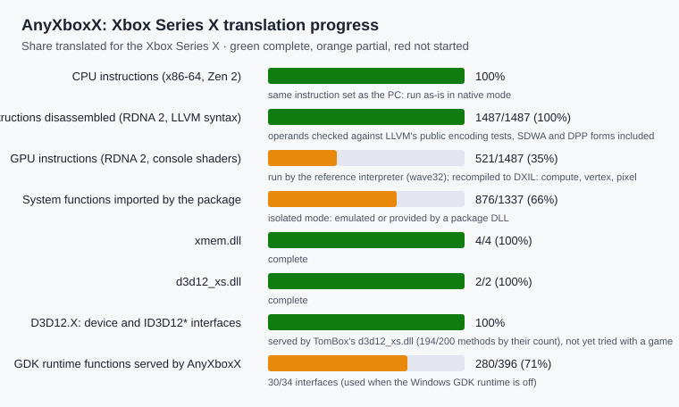

# AnyXboxX — эмулятор Xbox Series X (прототип)

[](https://discord.gg/TcX42vRyPU)

[English](../../README.md) · [Français](README.fr.md) · [Español](README.es.md) · [Deutsch](README.de.md) · [Italiano](README.it.md) · [Português](README.pt-BR.md) · [日本語](README.ja.md) · [中文](README.zh-CN.md) · **Русский**

> [!NOTE]
> **Где мы сейчас (24.11.2026)**
>
> Измерения на i7-13700KF + RTX 4070 SUPER, Windows 11, с форком VIctory `fxceless/victory-gta6` на коммите `7b0f736` (подмодуль `third_party/victory`), запуск через `tools/lancer_victory.ps1 -GameDir <папка игры>`:
>
> - ✅ Сборка GTA VI 1.0.2.1 для Xbox Series **запускается** на ПК: загрузка, экран профиля, настройки первого запуска, юридические экраны, загрузка уровня, меню паузы. Меню работают на 30 кадрах в секунду.
> - ✅ Игра доходит до **мира и отображает его**: персонаж двигается под управлением игрока и показывается 3D-изображение примерно на 4 кадрах в секунду (наблюдалось мейнтейнером, Windows 11, RTX 4070 Super).
> - ⛔ Текущее ограничение: устройство хоста теряется через несколько минут — примерно до 13 минут в мире, поэтому работа нестабильна. Предыдущая интеграция оставалась примерно на 2,4 кадра в секунду без 3D-изображения; с закреплённым форком мир отображается и играбелен примерно на 4 кадрах в секунду.
> - 👁 Наблюдалось мейнтейнером (Windows 11, RTX 4070 Super), с форком `fxceless/victory-gta6` на коммите `d279e69` и настройками лаунчера: игра работала примерно на 4 fps около 13 минут в стартовой зоне (тюрьма). Персонаж двигается под управлением игрока и взаимодействует с первыми NPC, затем устройство хоста теряется (известное ограничение).
> - 🆕 Закреплён с коммита `7b0f736` (включает `e9765a7`, "Fix the device loss introduced by the wave64 update"). Наблюдалось мейнтейнером (Windows 11, RTX 4070 Super), по журналу VIctory этого запуска, с `VICTORY_RELAY=2` и настройками лаунчера, кэш пайплайнов уже заполнен: мир достигнут примерно за 1 мин 25 с, 3,5 fps на первом кадре, затем 4,5 fps через 2 мин (около 4 975 draws на кадр, 346 потеряно из-за отсутствия пайплайна хоста), потери устройства не было примерно 2 мин 40 с в мире (затем окно было закрыто). Без `VICTORY_RELAY`: 5,4 fps примерно через 3 мин, без потерь. Мейнтейнер считает его немного лучше, чем `d279e69`. Нами пока не измерено: стабильность дольше 13 минут; issue №26 форка сообщает о 21,5 минуты стабильной работы на RTX 4060 Ti с `VICTORY_RELAY=2` (сообщение третьей стороны).
> - Требования: собственная копия игры, видеокарта NVIDIA или AMD с SM 6.6 и mesh shaders, Rust. В этом репозитории нет файлов игры.
> - Как запустить: [docs/running-gta6.md](../running-gta6.md).

AnyXboxX загружает исполняемые файлы Xbox GDK (формат PE32+ x86-64) и выполняет их код с помощью Unicorn. Системные функции консоли заменяются C++ рантаймом в нативном режиме и кодом на Python в изолированной машине (высокоуровневая эмуляция, как WinDurango или Wine). Программа представляется как Xbox Series X: `XSystemGetDeviceType` возвращает `XboxScarlettAnaconda`.

## Цель и состояние

AnyXboxX специализирован на одной сборке: **Grand Theft Auto VI для Xbox Series, версия 1.0.2.1**. Переводится только то, что нужно этой игре (импортируемые системные функции, используемые шейдеры и методы Direct3D 12.x). Другие игры будут пробоваться, когда этот перевод будет завершён. Проект опирается на [VIctory](https://github.com/Marvisak/VIctory) (Marvisak, GPL-3.0 или новее), нацеленный на ту же сборку: подмодуль `third_party/victory` закреплён на форке `fxceless/victory-gta6` (GPL-3.0), коммит `7b0f736`. Спасибо Marvisak и авторам этих pull request'ов, каждый из которых указан в [THIRD_PARTY.md](../../THIRD_PARTY.md).

> [!IMPORTANT]
> **В игру пока нельзя играть.** Актуальное состояние смотрите в блоке в начале страницы. Этот репозиторий не содержит файлов игры, ключей или исполняемых файлов и не объясняет, как их получить.

Страница статуса онлайн, с необходимым местом на диске: **[loopersalty.github.io/AnyXboxX](https://loopersalty.github.io/AnyXboxX/)**.

## Прогресс перевода


Перегенерация: `scarlett.py --carte <папка пакета> docs/images/carte-avancee.svg`.



- **Инструкции CPU: 100%.** Series X использует AMD Zen 2 в x86-64, тот же набор инструкций, что и на ПК: в нативном режиме код игры выполняется как есть, без перевода.
- **Инструкции GPU: 64%.** Шейдеры консольной игры компилируются под GPU RDNA 2 в Series X. 948 из 1 487 кодировок RDNA 2 работают в эталонном интерпретаторе, а рекомпилятор RDNA 2 → DXIL уже рисует первые вершинный и пиксельный шейдеры через D3D12.
- **Системные функции: 66%** из 1 337 функций, импортируемых DLL тестового пакета, разрешены в изолированном режиме.
- **Консольные DLL**: `xmem.dll` (4/4) и `d3d12_xs.dll` (2/2) переведены для функций, которые использует пакет. D3D12.X (устройство и интерфейсы `ID3D12*`) обслуживается `d3d12_xs.dll` от TomBox, с игрой пока не проверялось.
- **Рантайм GDK: 210 из 396 функций** написаны в AnyXboxX на C++: очередь задач (`XTaskQueue`, `XAsync`, `XThread`), пользователь (`XUser`, офлайн-локальный профиль), идентичность Xbox Series X (`XSystem`, Title ID, аналитика, возможности рантайма), сохранения (`XGameSave`, `XGameSaveFiles`, `XPersistentLocalStorage`), пакет игры (`XPackage`), офлайн-магазин (`XStore`: локальная лицензия игры, пустые запросы о продуктах), а также офлайн-приглашения, активации и отчёты об ошибках (`XGameInvite`, `XGameActivation`, `XGameProtocol`, `XError`), плюс реальное состояние HDR и сетевое подключение ПК (`XDisplayTryEnableHdrMode`, `XNetworkingGetConnectivityHint`). Они используются, когда AnyXboxX управляет рантаймом самостоятельно: без Gaming Services или с `ANYXBOXX_SYSTEM_RUNTIME=0`. Если рантайм Windows GDK присутствует, он обслуживает все интерфейсы, включая очередь задач, потому что его API принимают только его собственные очереди. Трассировка (`ANYXBOXX_TRACE=1`) называет каждый запрошенный интерфейс.

Диаграмма перегенерируется командой `scarlett.py --traduction <папка пакета> docs/images/traduction.svg`.

## Производительность (цель: стабильные 60 кадров в секунду)

```powershell
.\.venv\Scripts\python.exe .\PrototypeScarlett\scarlett.py --banc-perf <jeu.exe> [secondes] [courbe.svg]
.\.venv\Scripts\python.exe .\PrototypeScarlett\scarlett.py --natif <jeu.exe> --fps
```

C++ рантайм измеряет время каждого `Present` цепочки обмена DXGI игры, в том числе когда DXGI загружается динамически одной из DLL игры (SDL3). Из этого он вычисляет кадры в секунду, среднее время кадра и «1% low» (частоту самых медленных 1% кадров, которая выявляет рывки). `--fps` показывает эти значения в заголовке окна. `--banc-perf` измеряет N секунд, пропуская первую (загрузка), и выдаёт вердикт «стабильные 60 fps» (код выхода 2, если цель не достигнута). Без этих опций ничего не перехватывается.


Обе тестовые игры работают без вертикальной синхронизации: около 11 700 fps для SimpleTriangle и 12 600 fps для testgdk в нативном режиме.

## Ход проекта

| Этап | Статус |
|---|---|
| Чтение `MicrosoftGame.Config` (TitleId, идентичность, исполняемый файл Scarlett) | ✅ готово |
| Загрузка PE32+: секции и защиты, релокации, импорты, экспорты | ✅ готово |
| TLS: копия шаблона, индекс, колбэки | ✅ готово |
| TEB и PEB доступны через регистр GS | ✅ готово |
| Страница HLE: 158 эмулируемых имён функций GDK, ядра, CRT и математики | ✅ готово |
| Неизвестные функции: `E_NOTIMPL` и запись в журнал вместо отказа | ✅ готово |
| Глобальные конструкторы C++ (`_initterm`) выполняются как гостевой код | ✅ готово |
| Отчёт о совместимости (`--rapport`) и тестовый стенд (`--banc`) | ✅ готово |
| Несколько связанных модулей в одной машине: DLL пакета, ординалы, форвардеры, релокация при конфликте | ✅ готово |
| `GetModuleHandle`, `GetProcAddress`, `LoadLibrary`, `RtlPcToFileHeader` | ✅ готово |
| 16/16 DLL пакета Scarlett инициализированы со своими зависимостями, 0 неэмулированных вызовов | ✅ готово |
| Скомпилирована бесплатная тестовая игра `SimpleTriangle`: старт C и инициализация GDK работают в AnyXboxX | ✅ готово |
| Нативное выполнение в стиле Wine (`--natif`): **SimpleTriangle отображается**, рантайм GDK обслуживается AnyXboxX | ✅ готово |
| Вторая бесплатная тестовая игра, `testgdk` из SDL3: **работает в нативном режиме** (окно, спрайты, звук) | ✅ готово |
| Изолированный запуск пакета или exe (`--lancer`) со списком вызовов для эмуляции | ✅ готово |
| C++ рантайм (`runtime/`): `xgameruntime.dll`, `xmem.dll`, `d3d12_xs.dll` предзагружаются в нативном режиме и обслуживают все DLL игры | ✅ готово |
| `xmem.dll`: `XMemAlloc`, `XMemFree` с расшифрованными `XALLOC_ATTRIBUTES` (раскладка ERA: куча и графическая память, выравнивание), хуки, `XMemVirtualQuery` (флаг графической памяти) | ✅ готово |
| `d3d12_xs.dll`: сериализация корневой сигнатуры, перенаправление в D3D12 ПК | ✅ готово |
| Таблица 396 функций GDK: интерфейс и номер метода, извлечённые из `xgameruntime.lib` (`tools/gdk_interfaces.py`) | ✅ готово |
| `XTaskQueue`, `XAsync`, `XThread` обслуживаются AnyXboxX: testgdk работает без рантайма Windows | ✅ готово |
| Другие интерфейсы GDK: делегируются рантайму Windows GDK, называются трассировкой | 🟡 в работе |
| 832 автоматических тестов | ✅ готово |
| D3D12.X: `D3D12XboxCreateDevice`, консольные интерфейсы `ID3D12*` и `DXGIXPresentArray`, обслуживаются Rust-библиотекой `d3d12_xs.dll` от TomBox (MIT, 48 реализованных экспортов, собирается `tools/build_tombox.py d3d12_xs`, загружается через `ANYXBOXX_D3D12_XS=<путь>`); здесь не проверить без консольного исполняемого файла | 🟡 в работе |
| Консольные библиотеки TomBox (Rust, GPL-3.0) для того, чего не хватает AnyXboxX: `xg_xs` (раскладки текстур, 23 экспорта) и полный `xmem` (38 экспортов), с `ANYXBOXX_TOMBOX_DIR=<папка>`; собираются `tools/build_tombox.py xg_xs xmem` | 🟡 в работе |
| Офлайн `XUser`: всегда авторизованный локальный профиль, настраиваемый gamertag (`ANYXBOXX_GAMERTAG`), вход в testgdk успешен | ✅ готово |
| Идентичность Xbox Series X: тип консоли (имитируемое значение реестра `ConsoleMode`, в том числе внутри DLL игры), `XSystem`, Title ID из `MicrosoftGame.config`, аналитика «Xbox Series X» | ✅ готово |
| Карта прогресса: одна ячейка на функцию (`--carte`) | ✅ готово |
| Контроллер (`GameInput`) и звук (`XAudio2`): один и тот же API на консоли и ПК, привязаны к DLL Windows в нативном режиме | ✅ готово |
| Отчёт в Markdown о недостающих импортах по DLL и о неэмулированных вызовах (`--lancer … --md rapport.md`) | ✅ готово |
| Инструмент первого запуска консольного исполняемого файла: инвентаризация, кто предоставляет каждый импорт (пакет, AnyXboxX, TomBox, Windows, отсутствует), изолированные запуски, необязательный нативный запуск; отчёт хранится вне репозитория: `python tools/jour_j.py <пакет> [--natif]` ([руководство](../day-one.md), на французском) | ✅ готово |
| Счётчик кадров (`--fps`) и стенд производительности с вердиктом «стабильные 60 fps» и кривой (`--banc-perf`) | ✅ готово |
| Сохранения `XGameSave` (контейнеры, блобы, квота, асинхронное чтение) и постоянное локальное хранилище на диске ПК (`%LOCALAPPDATA%\AnyXboxX\<TitleId>` или `ANYXBOXX_SAVE_DIR`) | ✅ готово |
| `XPackage`: локально установленный пакет (идентификатор, язык, готовые чанки, монтирование в папку игры) | ✅ готово |
| `kernelx.dll` (консольное ядро): 2 661 функция перенаправлена в Windows `kernel32`/`kernelbase` | ✅ готово |
| Неявный TLS (`thread_local`) для игр в нативном режиме: DLL-носитель `anyxboxx_tls.dll`, каждый поток получает собственную копию (до 256 КиБ) | ✅ готово |
| Нативный C++ лаунчер без Python (`runtime/build/bin/anyxboxx.exe <game.exe \| папка> [--fps]`): SimpleTriangle и testgdk при ~12 000 fps | ✅ готово |
| Дизассемблер GPU RDNA 2: 1 487 мнемоник и операнды в синтаксисе LLVM (скалярные, VOP1/VOP2/VOPC/VOP3/VOP3P/SDWA/DPP/SMEM/DS/EXP/MUBUF/MTBUF/MIMG/FLAT с модификаторами), сверено с 35 088 публичными кодировками LLVM: `scarlett.py --rdna2 <shader.bin> [--liste]` | 🟡 в работе |
| Операнды дизассемблера RDNA 2 идентичны тексту LLVM: скалярные и VOP1/VOPC 100%, DS 100%, EXP 100%, SMEM 96,5% (максимум: LLVM записывает остальные кодировки двумя способами) | ✅ готово |
| Первые вершинный и пиксельный шейдеры RDNA 2, нарисованные через D3D12 (`anyxboxx_gpu_run.exe --draw`): каждая вершина и каждый пиксель идентичны эталонному интерпретатору, на GPU и на WARP | ✅ готово |
| Текстуры в рекомпилированных шейдерах RDNA 2: дескрипторы T#/S# и `image_sample` (2D, ближайший тексель, wrap или clamp-to-edge, 8_8_8_8_UNORM и 32_32_32_32_FLOAT), идентично эталонному интерпретатору на GPU и на WARP, включая текстурированный пиксельный шейдер; раскладка дескрипторов из Leonida и Mesa | ✅ готово |
| Второй транслятор RDNA 2 → SPIR-V (Vulkan): от Leonida (GPL-3.0), скопирован без изменений в `third_party/leonida/` и питается собственным дизассемблером AnyXboxX, без `llvm-mc`; вершинные, пиксельные и вычислительные шейдеры; 51 из 52 консольных шейдеров, входящих в `XboxBvhBuilder.dll` пакета, переводятся, измерено локально через `tools/fssm_mesure.py` (`scarlett.py --rdna2 <shader.bin> --spirv ps`) | 🟡 в работе |
| TomBox обновлён до последней версии (D3D12.X: 194 из 200 методов по их количеству) и собраны и обслуживаются из `ANYXBOXX_TOMBOX_DIR` ещё 4 его консольные библиотеки: `d3d12_x` (ESRAM), `XAudio2_9` (голоса XMA), `xapu`, `xgs12`; `tools/build_tombox.py d3d12_xs xg_xs xmem d3d12_x xaudio2_9 xapu xgs12` | 🟡 в работе |
| Ретаргет консольного DXIL в DXIL для ПК (`dxil-ms-xb2` → `dxil-ms-dx`, без перехода через HLSL): инструмент Xbox2Windows (MIT), скопирован без изменений в `third_party/xbox2windows/` вместе с тестом; `python third_party/xbox2windows/tools/dxil_retarget.py <in> <out>` или `--pe <game.exe>` | ✅ готово |
| Проверки pull request'ов: lint и синхронизация 9 README (строки, изображения, число тестов) при каждом pull request | ✅ готово |
| Консольные текстуры на Rust: декодирование BC7 и детайлинг GFX10 `SW_4K_S`, портированные из Xbox2Windows (MIT), воспроизводят их эталонные хеши; `anyxboxx_texture bc7 <blocks.bin> <w> <h> <out.png> [--4k-s]` | 🟡 в работе |
| Другие интерфейсы GDK, написанные AnyXboxX (`XGameUi`, `XNetworking`…) | ⏳ предстоит |
| Рекомпилятор шейдеров RDNA 2 → DXIL: первые программы переведены в HLSL, скомпилированы в DXIL и выполнены на GPU ПК через D3D12 (`--hlsl`, `anyxboxx_gpu_run.exe`, WARP без GPU), память идентична эталонному интерпретатору wave32, выполняющему 948 из 1 487 кодировок (скалярные, VOP1/VOP2/VOPC/VOP3, память: SMEM, LDS, GLOBAL, MUBUF с границами V#, атомарные операции, ветвления, расхождение `exec`); первые вершинный и пиксельный шейдеры (экспорты EXP, интерполяция VINTRP) нарисованы через D3D12, идентично вершина в вершину и пиксель в пиксель: `scarlett.py --rdna2 <shader.bin> --executer` | 🟡 в работе |
| Кэш шейдеров: переведённые шейдеры компилируются в DXIL один раз, затем используются с диска (1,4 мс) или из памяти (0,8 мс) вместо dxc (22 мс); `%LOCALAPPDATA%\AnyXboxX\shader-cache` или `ANYXBOXX_SHADER_CACHE`, с ограничением размера | 🟡 в работе |
| GTA VI Xbox Series 1.0.2.1 через VIctory (`third_party/victory`, форк `fxceless/victory-gta6` на `7b0f736`): мир отображается и играбелен примерно на 4 fps (наблюдалось мейнтейнером, Windows 11, RTX 4070 Super); устройство хоста теряется через несколько минут — примерно до 13 минут | 🟡 в работе |
| Исключения x64 SEH (`.pdata`), несколько потоков | ⏳ предстоит |
| Динамическая загрузка DLL во время выполнения (`LoadLibrary` + `DllMain`) | ⏳ предстоит |
| Графика D3D12.X в Direct3D 12 / Vulkan | ⏳ предстоит |
| Консольный звук XMA2: декодируется в WAV Rust-портом декодера FFmpeg от TomBox (LGPL, 1 LSB от FFmpeg на публичном образце FATE); `anyxboxx_xma <in.xma> <out.wav>`, файлы с одним потоком | 🟡 в работе |

<table>
<tr>
<td></td>
<td></td>
</tr>
<tr>
<td align="center">Демо реагирует на стрелки клавиатуры.</td>
<td align="center">В журнале виден отчёт о совместимости.</td>
</tr>
</table>

## Попробовать демо

В Windows установите 64-разрядный Python 3.12 с Tcl/Tk, затем откройте PowerShell в корне репозитория.

```powershell
py -3.12 -m venv .venv
.\.venv\Scripts\python.exe -m pip install -r requirements.txt
.\.venv\Scripts\python.exe .\PrototypeScarlett\scarlett.py --demo
```

Нативному режиму нужен C++ рантайм. Он собирается с помощью Visual Studio 2022 или 2026 (рабочая нагрузка C++) и CMake:

```powershell
cmake -S runtime -B runtime/build -A x64
cmake --build runtime/build --config Release
```

Очередь задач использует модуль `Task` из [libHttpClient](https://github.com/microsoft/libHttpClient) (лицензия MIT, `runtime/third_party/libhttpclient-task`). DLL оказываются в `runtime/build/bin` или в папке, заданной `ANYXBOXX_RUNTIME`. `ANYXBOXX_SYSTEM_RUNTIME=0` отключает делегирование рантайму Windows GDK.

Скомпилированная демонстрационная программа — `PrototypeScarlett/demo.pe`; её исходный код — `PrototypeScarlett/demo.c`.

## Запуск игры в нативном режиме

```powershell
.\.venv\Scripts\python.exe .\PrototypeScarlett\scarlett.py --natif <dossier ou fichier .exe> [dossiers de DLL…]
```


AnyXboxX сам загружает исполняемый файл и выполняет его прямо на процессоре, как Wine. Рантайм Xbox (`xgameruntime.dll`) предоставляется AnyXboxX; окно и DirectX 12 — от ПК. **Внимание: в нативном режиме программа не изолирована.** Используйте этот режим только для доверенных программ; `--rapport` и `--banc` остаются изолированными внутри Unicorn. `ANYXBOXX_TRACE=1` показывает перехваченные вызовы. Подробности: [docs/test-game.md](../test-game.md).

## Запуск пакета в изолированном режиме

```powershell
.\.venv\Scripts\python.exe .\PrototypeScarlett\scarlett.py --lancer <dossier du paquet ou fichier .exe> [dossiers de DLL…]
```

Для папки AnyXboxX читает `MicrosoftGame.Config`, берёт исполняемый файл, объявленный для `Scarlett`, и запускает его в изолированной машине (Unicorn): программа не затрагивает ПК. Отчёт перечисляет неразрешённые импорты, затем неэмулированные вызовы, от самых частых к самым редким: это список дел для завершения эмулятора. Если исполняемого файла нет, сообщение называет его. С `--md rapport.md` тот же отчёт записывается в Markdown, с недостающими импортами, сгруппированными по DLL.

## Анализ программы

```powershell
.\.venv\Scripts\python.exe .\PrototypeScarlett\scarlett.py --rapport <dossier ou fichier .exe>
```

Тестовый стенд загружает все PE-модули в папке и выполняет их инициализацию:

```powershell
.\.venv\Scripts\python.exe .\PrototypeScarlett\scarlett.py --banc <dossier>
```


Подробные результаты: [docs/progress.md](../progress.md). Бесплатная тестовая игра в сравнении с её нативным выполнением: [docs/test-game.md](../test-game.md). Дополнительную папку с DLL (например, DLL Visual C++) можно указать после цели: `--rapport <cible> <dossier>`.

Отчёт перечисляет импортируемые функции, процент уже эмулированных и недостающие функции. В интерфейсе кнопка **Open an Xbox folder…** читает `MicrosoftGame.Config`, показывает этот отчёт, затем запускает программу; каждый неэмулированный вызов появляется в журнале.

## Архитектура


| Модуль | Роль |
|---|---|
| `emu/config.py` | читает манифест пакета GDK |
| `emu/loader.py` | загружает образ PE и подготавливает импорты, экспорты и TLS |
| `emu/machine.py` | процессор Unicorn, стек, куча, TEB/PEB, диспетчеризация вызовов |
| `emu/hle/` | эмулируемые функции: `gdk.py`, `kernel.py`, `crt.py`, `libm.py`, `guest.py` |
| `emu/report.py` | отчёт о совместимости |
| `emu/modules.py` | загружает DLL пакета, связывает импорты, упорядочивает инициализации |
| `emu/bench.py` | тестовый стенд для папки модулей |
| `emu/native/` | нативное выполнение в стиле Wine: загрузчик, реальные импорты, рантайм GDK от AnyXboxX |
| `scarlett.py` | интерфейс Tkinter и командная строка |

Чтобы добавить функцию, пометьте декоратором обработчик в `emu/hle/`:

```python
@hle("gdk")
def XSystemGetDeviceType(c):
    return XBOX_SERIES_X
```

## Исследования

- [Аппаратная архитектура Xbox Series X](../research/xbox-series-x-architecture.md): CPU Zen 2, GPU RDNA 2, память, Velocity Architecture, безопасность.
- [Существующие эмуляторы и слои совместимости](../research/state-of-the-art.md): WinDurango, XWine1, Xenia, инструменты XVD.
- [Заметки по реверс-инжинирингу изученного пакета Scarlett](../research/package/README.md) (написаны Codex): таблицы RDS5/ETPF, заголовки RPF, структура пакета.
- [TomBox и его продолжение](../research/tombox.md): консольные DLL на Rust, Direct3D 12.x, транслятор шейдеров RDNA 2, что AnyXboxX использует повторно (MIT, указано авторство).
- [Xbox2Windows](../research/xbox2windows.md): исследование статической рекомпиляции; BC7 и тайлинг GFX10 используются в AnyXboxX повторно (MIT, указано авторство).
- [Первая загрузка исполняемого файла 1.0.2.1](../research/first-boot-1021.md): остановки, по порядку измеренные под `gta6rt` от Leonida, pull request'ы Leonida, которые их устраняют, список работ для AnyXboxX.

## Тесты

```powershell
.\.venv\Scripts\python.exe -m pip install -r requirements-dev.txt
.\.venv\Scripts\python.exe -m pytest
```

## Участие в проекте

Ветка `main` защищена: любой вклад проходит через проверенный pull request, и тесты должны проходить. Об ошибках и функциях для эмуляции сообщайте в issues. Полные правила — в [CONTRIBUTING.md](../../CONTRIBUTING.md) (на французском).

Обсуждение, помощь и отчёты о тестах: [Discord](https://discord.gg/TcX42vRyPU)

## Лицензия

AnyXboxX распространяется под [GNU GPL 3.0 или новее](../../LICENSE). Сторонние части сохраняют собственную лицензию: модуль `Task` из libHttpClient (MIT, `runtime/third_party/libhttpclient-task`) и таблицы RDNA 2, сгенерированные из публичных тестов кодировок LLVM (Apache 2.0 с исключением LLVM, `PrototypeScarlett/emu/rdna2_ops.py` и `rdna2_shapes.py`).

Сторонние компоненты и благодарности: [THIRD_PARTY.md](../../THIRD_PARTY.md).
