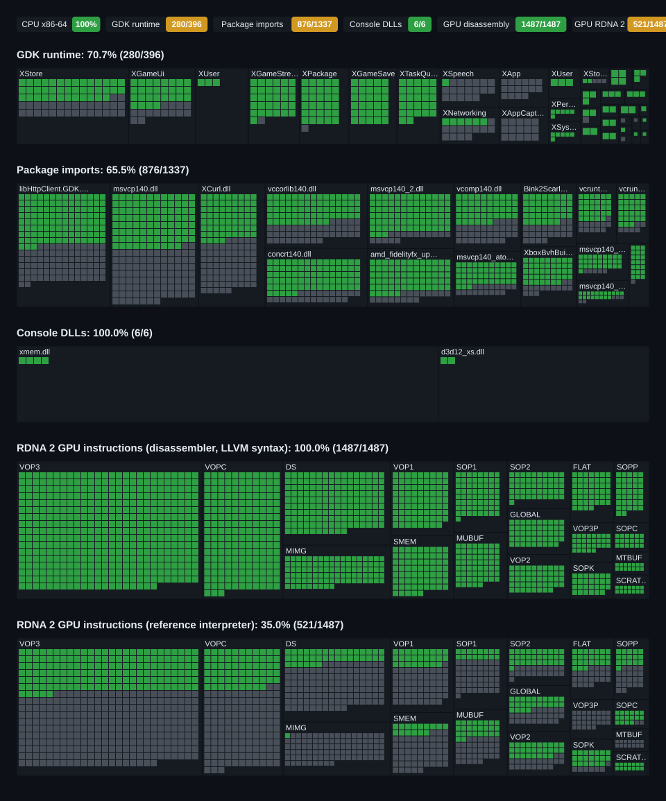

# AnyXboxX — Xbox Series X 模拟器（原型）

[](https://discord.gg/TcX42vRyPU)

[English](../../README.md) · [Français](README.fr.md) · [Español](README.es.md) · [Deutsch](README.de.md) · [Italiano](README.it.md) · [Português](README.pt-BR.md) · [日本語](README.ja.md) · **中文** · [Русский](README.ru.md)

> [!NOTE]
> **当前进展（2026-11-24）**
>
> 在 i7-13700KF + RTX 4070 SUPER、Windows 11 上实测，使用 VIctory 的分支仓库 `fxceless/victory-gta6` 的提交 `7b0f736`（子模块 `third_party/victory`），通过 `tools/lancer_victory.ps1 -GameDir <游戏文件夹>` 启动：
>
> - ✅ GTA VI 的 Xbox Series 1.0.2.1 版本**可以在 PC 上启动**：启动、档案界面、首次运行设置、法律声明界面、加载、暂停菜单。菜单为 30 fps。
> - ✅ 能到达**世界并显示出来**：角色可在玩家控制下移动，3D 图像可显示，帧率约为每秒 4 帧（维护者观察到，Windows 11，RTX 4070 Super）。
> - ⛔ 当前限制：在世界中经过几分钟到约 13 分钟后主机设备会丢失，因此并不稳定。之前的集成停留在约每秒 2.4 帧且没有 3D 图像；使用固定的分支后，世界可以显示并以约每秒 4 帧游玩。
> - 👁 维护者观察到（Windows 11，RTX 4070 Super）：使用 `fxceless/victory-gta6` 分支的提交 `d279e69` 和启动器设置，游戏在起始区域（监狱）以约 4 fps 运行了约 13 分钟。角色可在玩家控制下移动并与最初的 NPC 互动，随后主机设备丢失（已知限制）。
> - 🆕 自提交 `7b0f736`（包含 `e9765a7`，"Fix the device loss introduced by the wave64 update"）起固定。维护者观察到（Windows 11，RTX 4070 Super），来自该次运行的 VIctory 日志，使用 `VICTORY_RELAY=2` 和启动器设置，管线缓存已填满：约 1 分 25 秒进入世界，首帧 3.5 fps，2 分钟后 4.5 fps（每帧约 4,975 次 draw，因缺少主机管线丢失 346 次），在世界中约 2 分 40 秒内未丢失设备（随后窗口被关闭）。不使用 `VICTORY_RELAY` 时：约 3 分钟时 5.4 fps，无丢失。维护者认为比 `d279e69` “略好”。我们尚未测量：超过 13 分钟的稳定性；该分支的 issue #26 报告在 RTX 4060 Ti 上使用 `VICTORY_RELAY=2` 稳定运行 21.5 分钟（第三方报告）。
> - 要求：你自己的游戏副本、支持 SM 6.6 和 mesh shader 的 NVIDIA 或 AMD GPU、Rust。本仓库不包含任何游戏文件。
> - 运行方法：[docs/running-gta6.md](../running-gta6.md)。

AnyXboxX 加载 Xbox GDK 可执行文件（PE32+ x86-64 格式），并用 Unicorn 执行其代码。主机的系统函数在原生模式下由 C++ 运行时替代，在隔离的虚拟机中由 Python 代码替代（高级别模拟，与 WinDurango 或 Wine 类似）。该程序会表现为一台 Xbox Series X：`XSystemGetDeviceType` 返回 `XboxScarlettAnaconda`。

## 目标与现状

AnyXboxX 专注于一个版本：**Xbox Series 版《Grand Theft Auto VI》，版本 1.0.2.1**。只翻译这款游戏需要的部分（它导入的系统函数、它使用的着色器和 Direct3D 12.x 方法）。待这部分翻译完成后，再尝试其他游戏。本项目基于面向同一版本的 [VIctory](https://github.com/Marvisak/VIctory)（Marvisak，GPL-3.0 或更高版本）：子模块 `third_party/victory` 固定在分支仓库 `fxceless/victory-gta6`（GPL-3.0）的提交 `7b0f736`。感谢 Marvisak 和这些 pull request 的作者，逐一致谢见 [THIRD_PARTY.md](../../THIRD_PARTY.md)。

> [!IMPORTANT]
> **游戏目前无法游玩。** 当前进展见本页顶部的方框。本仓库不包含任何游戏文件、密钥或可执行文件，也不说明如何获取它们。

在线状态页面（含所需磁盘空间）：**[loopersalty.github.io/AnyXboxX](https://loopersalty.github.io/AnyXboxX/)**。

## 翻译进展



重新生成：`scarlett.py --carte <包文件夹> docs/images/carte-avancee.svg`。


- **处理器指令：100%。** Series X 使用 x86-64 的 AMD Zen 2，与 PC 的指令集相同：在原生模式下，游戏代码无需翻译，直接原样运行。
- **GPU 指令：51%。** 主机游戏的着色器是针对 Series X 的 RDNA 2 GPU 编译的。1,487 种 RDNA 2 编码中已有 763 种可在参考解释器中运行，RDNA 2 → DXIL 重编译器已能用 D3D12 绘制首个顶点着色器和像素着色器。
- **系统函数：66%。** 测试包中各 DLL 导入的 1 337 个函数里，有这个比例在隔离模式下已被解析。
- **主机专用 DLL**：`xmem.dll`（4/4）和 `d3d12_xs.dll`（2/2）已针对该包用到的函数完成翻译。D3D12.X（设备和 `ID3D12*` 接口）由 TomBox 的 `d3d12_xs.dll` 提供，尚未用游戏测试。
- **GDK 运行时：396 个函数中的 210 个**是在 AnyXboxX 中用 C++ 编写的：任务队列（`XTaskQueue`、`XAsync`、`XThread`）、用户（`XUser`，一个离线的本地档案）、Xbox Series X 的身份（`XSystem`、Title ID、分析数据、运行时功能）、存档（`XGameSave`、`XGameSaveFiles`、`XPersistentLocalStorage`）游戏包（`XPackage`），离线商店（`XStore`），以及离线的邀请、激活和错误报告（`XGameInvite`、`XGameActivation`、`XGameProtocol`、`XError`），以及 PC 的真实 HDR 状态和网络连接（`XDisplayTryEnableHdrMode`、`XNetworkingGetConnectivityHint`）。当 AnyXboxX 单独管理运行时（没有 Gaming Services，或使用 `ANYXBOXX_SYSTEM_RUNTIME=0`）时，它们才会生效。如果存在 Windows 的 GDK 运行时，则由它提供所有接口（包括任务队列），因为其 API 只接受它自己的队列。跟踪（`ANYXBOXX_TRACE=1`）会列出每个被请求接口的名称。

该图表由 `scarlett.py --traduction <包文件夹> docs/images/traduction.svg` 重新生成。

## 性能（目标：稳定 60 帧/秒）

```powershell
.\.venv\Scripts\python.exe .\PrototypeScarlett\scarlett.py --banc-perf <jeu.exe> [secondes] [courbe.svg]
.\.venv\Scripts\python.exe .\PrototypeScarlett\scarlett.py --natif <jeu.exe> --fps
```

C++ 运行时会为游戏 DXGI 交换链的每次 `Present` 计时，即使 DXGI 是由游戏的某个 DLL（SDL3）动态加载的也一样。它由此得出每秒帧数、单帧平均耗时和“1% 低值”（最慢的 1% 帧的速率，可以反映卡顿）。`--fps` 会把这些数值显示在窗口标题中。`--banc-perf` 测量 N 秒，不计入第一秒（加载），并给出“稳定 60 帧/秒”的结论（未达标时返回码为 2）。不使用这些选项时，不会拦截任何内容。


两个测试游戏都在关闭垂直同步的情况下运行：原生模式下，SimpleTriangle 约 11,700 帧/秒，testgdk 约 12,600 帧/秒。

## 项目进展

| 步骤 | 状态 |
|---|---|
| 读取 `MicrosoftGame.Config`（TitleId、标识、Scarlett 可执行文件） | ✅ 已完成 |
| PE32+ 加载：节与保护属性、重定位、导入、导出 | ✅ 已完成 |
| TLS：模板复制、索引、回调 | ✅ 已完成 |
| 可通过 GS 寄存器访问 TEB 和 PEB | ✅ 已完成 |
| HLE 页：模拟了 158 个 GDK、内核、CRT 和数学函数名 | ✅ 已完成 |
| 未知函数：返回 `E_NOTIMPL` 并写入日志，而不是拒绝 | ✅ 已完成 |
| 全局 C++ 构造函数（`_initterm`）以客体代码方式运行 | ✅ 已完成 |
| 兼容性报告（`--rapport`）和测试台（`--banc`） | ✅ 已完成 |
| 在同一台机器中运行多个相互链接的模块：包中的 DLL、序号、转发、冲突时重定位 | ✅ 已完成 |
| `GetModuleHandle`、`GetProcAddress`、`LoadLibrary`、`RtlPcToFileHeader` | ✅ 已完成 |
| Scarlett 包中的 16/16 个 DLL 连同依赖项完成初始化，0 个未模拟的调用 | ✅ 已完成 |
| 已编译免费测试游戏 `SimpleTriangle`：C 启动代码和 GDK 初始化可在 AnyXboxX 中通过 | ✅ 已完成 |
| Wine 式原生执行（`--natif`）：**SimpleTriangle 成功显示**，GDK 运行时由 AnyXboxX 提供 | ✅ 已完成 |
| 第二个自由测试游戏，SDL3 的 `testgdk`：**以原生模式运行**（窗口、精灵、声音） | ✅ 已完成 |
| 隔离启动游戏包或 exe（`--lancer`），并给出需要模拟的调用列表 | ✅ 已完成 |
| C++ 运行时（`runtime/`）：`xgameruntime.dll`、`xmem.dll`、`d3d12_xs.dll` 在原生模式下预先加载，并提供给游戏的所有 DLL | ✅ 已完成 |
| `xmem.dll`：解码 `XALLOC_ATTRIBUTES` 的 `XMemAlloc`、`XMemFree`（ERA 布局：堆内存和图形内存、对齐）、钩子、`XMemVirtualQuery`（图形内存标志） | ✅ 已完成 |
| `d3d12_xs.dll`：根签名序列化，重定向到电脑的 D3D12 | ✅ 已完成 |
| 396 个 GDK 函数的表：接口和方法编号，提取自 `xgameruntime.lib`（`tools/gdk_interfaces.py`） | ✅ 已完成 |
| `XTaskQueue`、`XAsync`、`XThread` 由 AnyXboxX 提供：testgdk 无需 Windows 的运行时即可运行 | ✅ 已完成 |
| 其他 GDK 接口：委托给 Windows 的 GDK 运行时，由跟踪列出名称 | 🟡 进行中 |
| 717 个自动化测试 | ✅ 已完成 |
| D3D12.X：`D3D12XboxCreateDevice`、主机的 `ID3D12*` 接口和 `DXGIXPresentArray`，由 TomBox 的 Rust 版 `d3d12_xs.dll` 提供（MIT，48 个已实现导出，用 `tools/build_tombox.py d3d12_xs` 构建，通过 `ANYXBOXX_D3D12_XS=<路径>` 加载）；没有主机可执行文件，此处无法测试 | 🟡 进行中 |
| 用 TomBox（Rust，GPL-3.0）的主机库补足 AnyXboxX 缺少的部分：`xg_xs`（纹理布局，23 个导出）和完整的 `xmem`（38 个导出），通过 `ANYXBOXX_TOMBOX_DIR=<文件夹>` 使用；由 `tools/build_tombox.py xg_xs xmem` 构建 | 🟡 进行中 |
| 离线 `XUser`：始终已登录的本地档案、可设置的游戏玩家标签（`ANYXBOXX_GAMERTAG`）、testgdk 登录成功 | ✅ 已完成 |
| Xbox Series X 的身份：主机类型（模拟注册表值 `ConsoleMode`，游戏的 DLL 内同样有效）、`XSystem`、从 `MicrosoftGame.config` 读取的 Title ID、“Xbox Series X”分析数据 | ✅ 已完成 |
| 进展地图：每个函数一格（`--carte`） | ✅ 已完成 |
| 手柄（`GameInput`）与音频（`XAudio2`）：主机与 PC 使用相同的 API，原生模式下绑定到 Windows 的 DLL | ✅ 完成 |
| 按 DLL 列出缺失导入与未模拟调用的 Markdown 报告（`--lancer … --md rapport.md`） | ✅ 完成 |
| 主机可执行文件首次启动工具：清单、每个导入的提供者（游戏包、AnyXboxX、TomBox、Windows、缺失）、隔离运行、可选的原生运行；报告保存在仓库之外：`python tools/jour_j.py <游戏包> [--natif]`（[指南](../day-one.md)，法语） | ✅ 完成 |
| 帧计数器（`--fps`）与性能测试台，给出“恒定 60 fps”结论和曲线（`--banc-perf`） | ✅ 完成 |
| `XGameSave` 存档（容器、blob、配额、异步读取）和持久化本地存储，保存在 PC 的磁盘上（`%LOCALAPPDATA%\AnyXboxX\<TitleId>`，或 `ANYXBOXX_SAVE_DIR`） | ✅ 已完成 |
| `XPackage`：本地安装的包（标识符、语言、已就绪的数据块、挂载到游戏文件夹） | ✅ 已完成 |
| `kernelx.dll`（主机内核）：2,661 个函数转发到 Windows 的 `kernel32`/`kernelbase` | ✅ 完成 |
| 原生模式下游戏的隐式 TLS（`thread_local`）：载体 DLL `anyxboxx_tls.dll`，每个线程获得自己的副本（最多 256 KiB） | ✅ 完成 |
| 不依赖 Python 的 C++ 原生启动器（`runtime/build/bin/anyxboxx.exe <游戏.exe \| 文件夹> [--fps]`）：SimpleTriangle 和 testgdk 约 12,000 帧/秒 | ✅ 完成 |
| RDNA 2 GPU 反汇编器：1,487 个助记符及 LLVM 语法的操作数（标量、VOP1/VOP2/VOPC/VOP3/VOP3P/SDWA/DPP/SMEM/DS/EXP/MUBUF/MTBUF/MIMG/FLAT 及修饰符），已用 LLVM 的 35,088 条公开编码验证：`scarlett.py --rdna2 <shader.bin> [--liste]` | 🟡 进行中 |
| RDNA 2 反汇编器的操作数与 LLVM 文本一致：标量和 VOP1/VOPC 100%、DS 100%、EXP 100%、SMEM 96.5%（最大值：其余编码 LLVM 有两种写法） | ✅ 已完成 |
| 首个 RDNA 2 顶点着色器和像素着色器已用 D3D12 绘制（`anyxboxx_gpu_run.exe --draw`）：每个顶点和每个像素都与参考解释器一致（GPU 和 WARP） | ✅ 已完成 |
| 重编译的 RDNA 2 着色器中的纹理：T#/S# 描述符和 `image_sample`（2D、最近纹素、wrap 或 clamp-to-edge、8_8_8_8_UNORM 和 32_32_32_32_FLOAT），包括带纹理的像素着色器在内，在 GPU 和 WARP 上与参考解释器一致；描述符布局来自 Leonida 和 Mesa | ✅ 已完成 |
| 第二个 RDNA 2 → SPIR-V（Vulkan）转换器：Leonida 的转换器（GPL-3.0），原样复制到 `third_party/leonida/`，由 AnyXboxX 自己的反汇编器提供输入，无需 `llvm-mc`；支持顶点、像素和计算着色器；包中 `XboxBvhBuilder.dll` 自带的 52 个主机着色器中有 51 个可转换（用 `tools/fssm_mesure.py` 在本地测量）（`scarlett.py --rdna2 <shader.bin> --spirv ps`） | 🟡 进行中 |
| TomBox 更新到最新版本（D3D12.X：按他们的统计 200 个方法中已实现 194 个），并额外构建 4 个主机库，从 `ANYXBOXX_TOMBOX_DIR` 提供：`d3d12_x`（ESRAM）、`XAudio2_9`（XMA 声部）、`xapu`、`xgs12`；`tools/build_tombox.py d3d12_xs xg_xs xmem d3d12_x xaudio2_9 xapu xgs12` | 🟡 进行中 |
| 将主机 DXIL 转换为 PC DXIL（`dxil-ms-xb2` → `dxil-ms-dx`，无需经过 HLSL）：Xbox2Windows 的工具（MIT），连同其测试原样复制到 `third_party/xbox2windows/`；`python third_party/xbox2windows/tools/dxil_retarget.py <输入> <输出>` 或 `--pe <game.exe>` | ✅ 已完成 |
| 拉取请求检查：每个拉取请求都运行 lint 并核对 9 个 README 的同步（行、图片、测试数量） | ✅ 已完成 |
| Rust 实现的主机纹理：从 Xbox2Windows（MIT）移植的 BC7 解码和 GFX10 `SW_4K_S` 去平铺，复现了参考摘要；`anyxboxx_texture bc7 <blocks.bin> <宽> <高> <out.png> [--4k-s]` | 🟡 进行中 |
| 由 AnyXboxX 自行编写的其他 GDK 接口（`XGameUi`、`XNetworking`…） | ⏳ 待完成 |
| RDNA 2 → DXIL 着色器重编译器：首批程序已翻译为 HLSL、编译为 DXIL 并通过 D3D12 在 PC 的 GPU 上运行（`--hlsl`、`anyxboxx_gpu_run.exe`，无 GPU 时用 WARP），内存与 wave32 参考解释器的结果完全一致，该解释器可执行 1,487 种编码中的 763 种（标量、VOP1/VOP2/VOPC/VOP3、内存：SMEM、LDS、GLOBAL、带 V# 边界的 MUBUF、原子操作、分支、`exec` 分歧）；首个顶点着色器和像素着色器（EXP 导出、VINTRP 插值）已用 D3D12 绘制，逐顶点、逐像素一致：`scarlett.py --rdna2 <shader.bin> --executer` | 🟡 进行中 |
| 着色器缓存：翻译后的着色器只编译一次为 DXIL，之后从磁盘（1.4 ms）或内存（0.8 ms）复用，而不再调用 dxc（22 ms）；`%LOCALAPPDATA%\AnyXboxX\shader-cache` 或 `ANYXBOXX_SHADER_CACHE`，大小有上限 | 🟡 进行中 |
| 通过 VIctory 运行 GTA VI Xbox Series 1.0.2.1（`third_party/victory`，分支仓库 `fxceless/victory-gta6` 的提交 `7b0f736`）：世界可显示，约 4 fps 可游玩（维护者观察到，Windows 11，RTX 4070 Super）；几分钟到约 13 分钟后主机设备会丢失 | 🟡 进行中 |
| x64 SEH 异常（`.pdata`）、多线程 | ⏳ 待完成 |
| 在运行时动态加载 DLL（`LoadLibrary` + `DllMain`） | ⏳ 待完成 |
| 将 D3D12.X 图形转换为 Direct3D 12 / Vulkan | ⏳ 待完成 |
| 主机 XMA2 音频：由 TomBox 将 FFmpeg 解码器移植到 Rust 的版本解码为 WAV（LGPL，在公开 FATE 样本上与 FFmpeg 最多相差 1）；`anyxboxx_xma <in.xma> <out.wav>`，单流文件 | 🟡 进行中 |

<table>
<tr>
<td></td>
<td></td>
</tr>
<tr>
<td align="center">演示会响应键盘方向键。</td>
<td align="center">日志中显示兼容性报告。</td>
</tr>
</table>

## 试用演示

在 Windows 上，安装带有 Tcl/Tk 的 64 位 Python 3.12，然后在仓库根目录打开 PowerShell。

```powershell
py -3.12 -m venv .venv
.\.venv\Scripts\python.exe -m pip install -r requirements.txt
.\.venv\Scripts\python.exe .\PrototypeScarlett\scarlett.py --demo
```

原生模式需要 C++ 运行时。可使用 Visual Studio 2022 或 2026（C++ 工作负载）和 CMake 编译：

```powershell
cmake -S runtime -B runtime/build -A x64
cmake --build runtime/build --config Release
```

任务队列沿用了 [libHttpClient](https://github.com/microsoft/libHttpClient) 的 `Task` 模块（MIT 许可证，`runtime/third_party/libhttpclient-task`）。DLL 会输出到 `runtime/build/bin`，或 `ANYXBOXX_RUNTIME` 指定的文件夹。`ANYXBOXX_SYSTEM_RUNTIME=0` 会关闭对 Windows GDK 运行时的委托。

编译好的演示程序是 `PrototypeScarlett/demo.pe`，其源代码是 `PrototypeScarlett/demo.c`。

## 以原生模式运行游戏

```powershell
.\.venv\Scripts\python.exe .\PrototypeScarlett\scarlett.py --natif <dossier ou fichier .exe> [dossiers de DLL…]
```


AnyXboxX 会加载可执行文件本身，并像 Wine 一样直接在处理器上运行它。Xbox 运行时（`xgameruntime.dll`）由 AnyXboxX 提供；窗口和 DirectX 12 则使用电脑自身的。**注意：在原生模式下，程序没有被隔离。** 请仅对可信的程序使用此模式；`--rapport` 和 `--banc` 仍然在 Unicorn 中隔离运行。`ANYXBOXX_TRACE=1` 会显示被拦截的调用。详情：[docs/test-game.md](../test-game.md)。

## 以隔离模式运行游戏包

```powershell
.\.venv\Scripts\python.exe .\PrototypeScarlett\scarlett.py --lancer <dossier du paquet ou fichier .exe> [dossiers de DLL…]
```

指定文件夹时，AnyXboxX 会读取 `MicrosoftGame.Config`，取出为 `Scarlett` 声明的可执行文件，并在隔离的虚拟机（Unicorn）中运行：程序不会接触电脑。报告先列出未解析的导入，再按出现频率从高到低列出未模拟的调用：这就是补全模拟器的工作清单。如果可执行文件缺失，提示信息会指明它的名称。按 `--md rapport.md` 参数运行时，同一份报告会以 Markdown 写出，缺失的导入按 DLL 分组。

## 分析程序

```powershell
.\.venv\Scripts\python.exe .\PrototypeScarlett\scarlett.py --rapport <dossier ou fichier .exe>
```

测试台会加载文件夹中的所有 PE 模块并运行它们的初始化：

```powershell
.\.venv\Scripts\python.exe .\PrototypeScarlett\scarlett.py --banc <dossier>
```


详细结果：[docs/progress.md](../progress.md)。与原生运行结果对比的免费测试游戏：[docs/test-game.md](../test-game.md)。目标之后可以再跟一个额外的 DLL 文件夹（例如 Visual C++ 的 DLL）：`--rapport <cible> <dossier>`。

报告会列出导入的函数、已模拟的百分比以及缺失的函数。在界面中，**Open an Xbox folder…**（打开 Xbox 文件夹）按钮会读取 `MicrosoftGame.Config`，显示该报告，然后启动程序；每个未模拟的调用都会出现在日志中。

## 架构


| 模块 | 作用 |
|---|---|
| `emu/config.py` | 读取 GDK 包的清单 |
| `emu/loader.py` | 加载 PE 映像，并准备导入、导出和 TLS |
| `emu/machine.py` | Unicorn 处理器、栈、堆、TEB/PEB、调用分发 |
| `emu/hle/` | 被模拟的函数：`gdk.py`、`kernel.py`、`crt.py`、`libm.py`、`guest.py` |
| `emu/report.py` | 兼容性报告 |
| `emu/modules.py` | 加载包中的 DLL、链接导入、安排初始化顺序 |
| `emu/bench.py` | 针对模块文件夹的测试台 |
| `emu/native/` | Wine 式原生执行：加载器、真实导入、AnyXboxX 的 GDK 运行时 |
| `scarlett.py` | Tkinter 界面和命令行 |

要添加一个函数，请在 `emu/hle/` 中为处理函数加上装饰器：

```python
@hle("gdk")
def XSystemGetDeviceType(c):
    return XBOX_SERIES_X
```

## 调研

- [Xbox Series X 的硬件架构](../research/xbox-series-x-architecture.md)：Zen 2 CPU、RDNA 2 GPU、内存、Velocity Architecture、安全性。
- [现有的模拟器和兼容层](../research/state-of-the-art.md)：WinDurango、XWine1、Xenia、XVD 工具。
- [所研究 Scarlett 游戏包的逆向工程笔记](../research/package/README.md)（(由 Codex 撰写）：RDS5/ETPF 表、RPF 文件头、游戏包结构。
- [TomBox 及其后续项目](../research/tombox.md)：Rust 编写的主机 DLL、Direct3D 12.x、RDNA 2 着色器翻译器，以及 AnyXboxX 复用的内容（MIT，已注明出处）。
- [Xbox2Windows](../research/xbox2windows.md)：静态重编译研究；AnyXboxX 复用其 BC7 与 GFX10 平铺（MIT，已注明出处）。
- [可执行文件 1.0.2.1 的首次启动](../research/first-boot-1021.md)：在 Leonida 的 `gta6rt` 下依次测得的停止点、处理这些问题的 Leonida 拉取请求，以及 AnyXboxX 的工作清单。

## 测试

```powershell
.\.venv\Scripts\python.exe -m pip install -r requirements-dev.txt
.\.venv\Scripts\python.exe -m pytest
```

## 参与贡献

`main` 分支受到保护：所有贡献都必须经过审阅的 pull request，并且测试必须通过。缺陷和需要模拟的函数请在 issue 中提交。完整规则见 [CONTRIBUTING.md](../../CONTRIBUTING.md)（法语）。

讨论、求助和测试报告：[Discord](https://discord.gg/TcX42vRyPU)。

## 许可证

AnyXboxX 以 [GNU GPL 3.0 或更高版本](../../LICENSE) 发布。第三方部分保留各自的许可证：libHttpClient 的 `Task` 模块（MIT，`runtime/third_party/libhttpclient-task`），以及根据 LLVM 公开编码测试生成的 RDNA 2 表（Apache 2.0 附 LLVM 例外，`PrototypeScarlett/emu/rdna2_ops.py` 和 `rdna2_shapes.py`）。

第三方组件与致谢：[THIRD_PARTY.md](../../THIRD_PARTY.md)。
